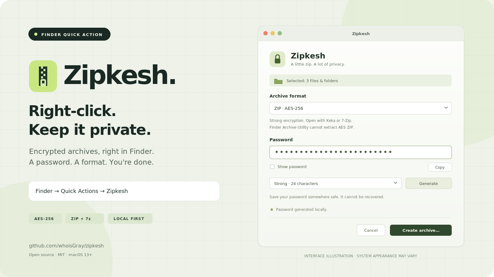

<p align="center">
  
</p>

<h1 align="center">Zipkesh | زیپ‌کش</h1>
<p align="center"><strong>کلیک راست کن، رمز بذار، زیپ کن.</strong><br>یک Quick Action کوچک برای Finder؛ بدون اپ جداگانه.</p>

<p align="center">
  <a href="https://github.com/whoisGray/zipkesh/actions/workflows/ci.yml"></a>
  
  <a href="LICENSE"></a>
</p>
<p align="center"><a href="README.md">English</a> · فارسی · <a href="docs/PUBLISH.md">راهنمای انتشار در گیت‌هاب</a></p>

فایل‌ها یا پوشه‌ها را در Finder انتخاب کن و از **Quick Actions / Services → Zipkesh — Encrypt Archive** وارد شو. در پنجرهٔ بومی macOS، فرمت و رمز را انتخاب کن و آرشیو را ذخیره کن. رابط برنامه انگلیسی است و با حالت روشن و تیرهٔ سیستم هماهنگ می‌شود.

تصویر بالا نمای گرافیکی رابط است؛ اسکرین‌شات اجرای واقعی روی مک نیست.

## نصب با یک دستور

نصب [آخرین نسخه](https://github.com/whoisGray/zipkesh/releases/latest):

```sh
/bin/bash -c "$(curl -fsSL https://raw.githubusercontent.com/whoisGray/zipkesh/main/install.sh)"
```

برای نصب از سورس دانلودشده یا کلون‌شده، داخل پوشهٔ پروژه اجرا کن:

```sh
bash install.sh
```

**پیش‌نیاز سیستم: macOS 13 به بالا، با پردازندهٔ Intel یا Apple Silicon.** نصب‌کننده Homebrew را پیدا یا نصب می‌کند، `7zip` و `python@3.13` را نصب می‌کند و پنجرهٔ بومی را با Apple Command Line Tools می‌سازد. روی مک تازه ممکن است رمز مدیر سیستم یا تأیید نصب ابزارهای اپل لازم شود. اگر macOS خواست نصب ابزارها را جداگانه تمام کنی، آن را کامل کن و همان دستور را دوباره بزن. برای دانلود پیش‌نیازها اینترنت و فضای خالی لازم است. پکیج پایتونی نیاز نیست.

خود Zipkesh در Library کاربر نصب می‌شود؛ اپی در Applications و آیکونی در Dock ندارد. پس از نصب، ساخت آرشیو کاملاً محلی و آفلاین است. دستور نصب سورس اجرایی دانلود می‌کند؛ در صورت تمایل اول کد آن را بررسی کن.

## استفاده

1. یک یا چند فایل یا پوشه را در Finder انتخاب کن.
2. کلیک راست → **Quick Actions** یا **Services** → **Zipkesh — Encrypt Archive**.
3. فرمت و پسورد را انتخاب کن. قبل از ادامه، پسورد را در جای مطمئنی نگه دار.
4. **Create archive…** را بزن و یک نام جدید و مسیر ذخیره انتخاب کن.
5. پس از رمزگذاری و بررسی سلامت آرشیو، **Show in Finder** فایل خروجی را نشان می‌دهد.

| فرمت | رمزگذاری | مخفی شدن نام فایل‌ها | ابزار بازکردن |
| --- | --- | --- | --- |
| ZIP · AES-256، پیش‌فرض | قوی | خیر | Keka، 7-Zip و ابزارهای سازگار با AES ZIP |
| 7z · AES-256 | قوی | بله | Keka، 7-Zip و ابزارهای سازگار با 7z |
| ZIP · Legacy compatibility | قدیمی و ضعیف، ZipCrypto | خیر | بسیاری از ابزارهای ZIP؛ با ابزار گیرنده امتحان کن |

Archive Utility خود Finder، AES ZIP و 7z را باز نمی‌کند. ZIP قدیمی فقط برای سازگاری است و برای اطلاعات حساس توصیه نمی‌شود. به‌دلیل محدودیت 7-Zip، پسورد ZIP باید از حروف انگلیسی، عدد و نمادهای ASCII باشد؛ برای پسورد فارسی از 7z استفاده کن. نام فایل فارسی در هر سه حالت پشتیبانی می‌شود.

## قابلیت‌ها

- **سه سبک پسورد:** قوی با ۲۴ کاراکتر؛ ساده‌تر برای تایپ با چهار گروه چهارتایی از حروف و اعداد تصادفی؛ بلند با ۴۸ کاراکتر. همگی با مولد تصادفی رمزنگاری ساخته می‌شوند.
- **پسورد دلخواه:** حداقل ۸ کاراکتر، حداکثر ۲۵۶ بایت UTF-8، بدون کاراکترهای کنترلی مثل خط جدید.
- **پنجرهٔ بومی:** نمایش و کپی رمز، انتخاب مسیر ذخیره، وضعیت عملیات و لغو.
- **جلوگیری از بازنویسی:** فایل موجود جایگزین نمی‌شود؛ نام جدید انتخاب کن.
- **بررسی سلامت خروجی:** آرشیو قبل از تحویل تست می‌شود؛ خروجی ناتمام در خطا یا لغو پاک می‌شود.
- **پاک‌سازی کلیپ‌بورد:** رمز کپی‌شده بعد از ۳۰ ثانیه، بستن عادی پنجره یا موفقیت عملیات پاک می‌شود، اگر محتوای کلیپ‌بورد عوض نشده باشد. رمز را قبل از ساخت آرشیو ذخیره کن.
- **انتقال خصوصی پسورد:** رمز وارد آرگومان خط فرمان، متغیر محیطی یا فایل لاگ نمی‌شود.
- **بدون حساب، تله‌متری، سرویس پس‌زمینه یا اتصال اینترنت هنگام آرشیو کردن.**

اگر فایل‌ها از پوشه‌های مختلف باشند، مسیر نسبی آن‌ها نسبت به والد مشترک حفظ می‌شود تا نام‌های یکسان تداخل نکنند. لینک‌های نمادین به‌صورت لینک ذخیره می‌شوند. خروجی را بیرون پوشه‌های انتخاب‌شده ذخیره کن. فایل‌های ابری را اول دانلود کن و هنگام فشرده‌سازی، سورس را تغییر نده.

این ابزار resource fork، extended attribute، ACL و تگ‌های Finder را حفظ نمی‌کند. خروجی را ترجیحاً روی دیسک محلی APFS/HFS+ ذخیره کن؛ بعضی دیسک‌های شبکه یا exFAT از hard link اتمیک موردنیاز پشتیبانی نمی‌کنند. ZIP نام پوشه‌های خالی و اطلاعات فهرست فایل‌ها را مخفی نمی‌کند. جزئیات در [SECURITY.md](SECURITY.md).

## اگر گزینه در Finder نبود

در **System Settings → Keyboard → Keyboard Shortcuts → Services** فعالش کن؛ معمولاً زیر Files and Folders است. بعضی نسخه‌های macOS آن را در Extensions یا **Quick Actions → Customize…** هم نشان می‌دهند. بعد از فعال کردن، منوی Finder را دوباره باز کن. اگر کش سرویس‌ها به‌روز نشد، یک‌بار از حساب macOS خارج و دوباره وارد شو. دسترسی به پوشه‌های محافظت‌شده ممکن است اجازهٔ خود macOS را بخواهد؛ فقط دسترسی لازم را بده.

## به‌روزرسانی و حذف

برای نسخهٔ جدید، نصب‌کنندهٔ همان نسخه را اجرا کن. نسخه‌های قبلی helper تا زمان حذف نگه داشته می‌شوند تا به‌روزرسانی پنجرهٔ در حال اجرا را خراب نکند. قبل از حذف، پنجره‌های Zipkesh را ببند.

```sh
bash "$HOME/Library/Application Support/Zipkesh/current/uninstall.sh"
```

فقط Zipkesh و سرویس Finder حذف می‌شوند. آرشیوها، Homebrew و وابستگی‌های مشترک باقی می‌مانند.

## تست و توسعه

```sh
brew install 7zip python@3.13
python3 -m unittest discover -s tests -v
bash scripts/check-macos.sh
```

موتور آرشیو با کتابخانهٔ استاندارد Python و 7-Zip کار می‌کند؛ پنجره با Swift/AppKit و اتصال به Finder با Automator ساخته شده است. تست macOS، کامپایل و ساخت پنجره، نصب، نصب مجدد، فایل‌های workflow و حذف را در یک Home موقت بررسی می‌کند. CI برای Linux و macOS آماده است. **تست خودکار جای تست دستی منوی Finder و مجوزهای macOS را نمی‌گیرد.** [نتیجهٔ بررسی‌های انجام‌شده و چک‌لیست انتشار](docs/TESTING.md) را ببین.

اگر Zipkesh چند کلیک از کارت کم کرد، یک ⭐ کمک می‌کند بقیه هم پیدایش کنند. گزارش باگ با فایل آزمایشی و نسخهٔ macOS خوشحالمان می‌کند.

[مجوز MIT](LICENSE) · ساختهٔ [whoisGray](https://github.com/whoisGray)
