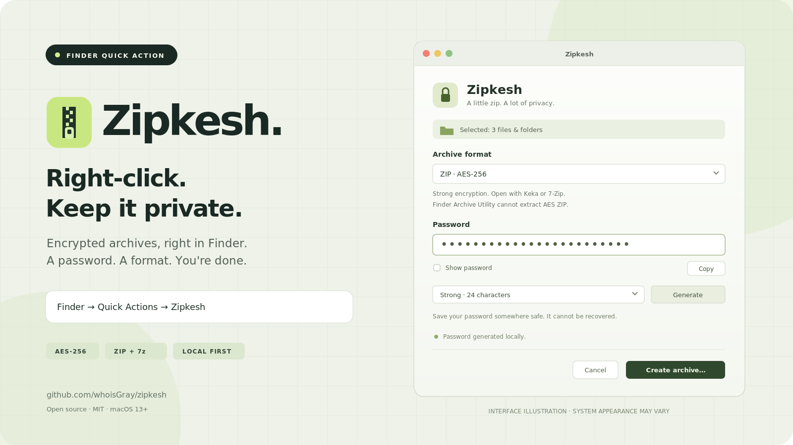

<p align="center">
  
</p>

<h1 align="center">Zipkesh</h1>
<p align="center"><strong>Right-click. Set a password. Zip.</strong><br>A small Finder Quick Action for encrypted archives. No standalone app.</p>

<p align="center">
  <a href="https://github.com/whoisGray/zipkesh/actions/workflows/ci.yml"></a>
  
  <a href="LICENSE"></a>
</p>
<p align="center">English · <a href="README.fa.md">فارسی</a> · <a href="docs/PUBLISH.md">Publish your fork / release</a></p>

Select files or folders in Finder, then choose **Quick Actions / Services →
Zipkesh — Encrypt Archive**. A native window lets you pick a format, generate or
enter a password, and save a verified archive.

The image above is an interface illustration, not a captured macOS screenshot.

## Install

After [v1.0.0](https://github.com/whoisGray/zipkesh/releases/tag/v1.0.0) has been published:

```sh
/bin/bash -c "$(curl -fsSL https://raw.githubusercontent.com/whoisGray/zipkesh/v1.0.0/install.sh)"
```

Or inspect a downloaded/cloned copy and install locally:

```sh
bash install.sh
```

**Requires macOS 13+**, Apple Silicon or Intel. The installer finds or installs
Homebrew, installs `7zip` and `python@3.13`, and builds the native Swift/AppKit
helper with Apple Command Line Tools. A clean Mac may ask for your administrator
password or approval for Apple's tools. If Apple asks you to finish that install
separately, finish it and re-run the same command. An internet connection and free
disk space for those prerequisites are required. No Python packages are needed.

Zipkesh itself lives in your user Library; it has no app in `/Applications` and
no Dock icon. Archive creation is local and works offline after installation.
The installer command downloads executable source; inspect it first if preferred.

## Use

1. Select one or more files/folders in Finder.
2. Right-click → **Quick Actions** or **Services** → **Zipkesh — Encrypt Archive**.
3. Choose a format and a password. Copy/save the password before continuing.
4. Click **Create archive…**, choose a new filename and destination, then save.
5. Zipkesh encrypts, tests the archive, and offers **Show in Finder**.

| Format | Encryption | Filenames hidden? | Open with |
| --- | --- | --- | --- |
| ZIP · AES-256 (default) | Strong | No | Keka, 7-Zip, other AES ZIP tools |
| 7z · AES-256 | Strong | Yes | Keka, 7-Zip, other 7z tools |
| ZIP · Legacy compatibility | Weak ZipCrypto | No | Many ZIP tools; test your recipient's extractor |

Finder's Archive Utility cannot extract AES ZIP or 7z. Legacy ZIP is an explicit
compatibility option, not a good choice for private material. ZIP passwords must
use ASCII characters (English letters, digits, symbols). Use 7z for a Persian or
other Unicode password. Persian filenames work in all three modes.

## Small details that matter

- **Three password styles:** Strong (24 characters), Easy to type (four groups of
  four random letters/digits), and Long (48 characters). All use cryptographic randomness.
- **Your own password:** 8+ characters, at most 256 UTF-8 bytes, no control characters.
- **Native window:** system light/dark appearance, Show/Copy, a save sheet and Cancel.
- **No silent overwrite:** choose a new filename; a completed archive never replaces an existing file.
- **Verification before delivery:** failed or cancelled jobs remove unfinished output.
- **Clipboard care:** explicitly copied passwords clear after 30 seconds or normal close,
  if the clipboard has not changed. Save the password before creating the archive.
- **Private password handoff:** no password in shell arguments, environment variables or log files.
- **No account, telemetry, background daemon, or network access during archiving.**

Files from different parent folders keep paths relative to their common parent,
so identical names do not collide. Symbolic links are stored as links. Save the
archive outside the selected folders. Cloud placeholders must be downloaded
first. Source files must stay unchanged while compression runs.

macOS resource forks, extended attributes, ACLs and Finder tags are not preserved.
Publish to a local APFS/HFS+ destination; some network/exFAT volumes do not support
the atomic hard-link operation used to avoid overwriting. ZIP cannot hide empty
folder names or other entry metadata. See [SECURITY.md](SECURITY.md).

## If the Finder action is missing

Enable it in **System Settings → Keyboard → Keyboard Shortcuts → Services**
(usually under Files and Folders). macOS versions may also show it in Extensions
or Finder's **Quick Actions → Customize…**. Reopen the Finder menu after enabling
it. If the service cache is stale, log out and back in. Files in protected
locations may trigger a macOS permission prompt; allow only the access needed.

## Update / uninstall

Re-run the installer for an available version. Existing windows keep their helper
version; close them before uninstalling. Previous helper versions are kept until
uninstall so an active window is not broken by an update.

```sh
bash "$HOME/Library/Application Support/Zipkesh/current/uninstall.sh"
```

This removes Zipkesh's helper and Finder service. Your archives, Homebrew and
shared dependencies are kept.

## Development and verification

```sh
brew install 7zip python@3.13
python3 -m unittest discover -s tests -v
bash scripts/check-macos.sh
```

The worker uses Python's standard library, `7zz`, and an echo-disabled PTY. The
window is Swift/AppKit; Automator supplies the Finder integration. The macOS
check builds the real UI, constructs its window, and validates install, reinstall,
workflow plists and uninstall in a temporary home. GitHub CI includes Linux and
macOS jobs. **Automated checks do not replace a manual Finder/permission test.**
See [the verification record and release checklist](docs/TESTING.md).

## Share it

If Zipkesh saves you a few clicks, a star helps other Mac users find it.
Bug reports with dummy files and your macOS version are welcome.

[MIT](LICENSE) · Made by [whoisGray](https://github.com/whoisGray)
